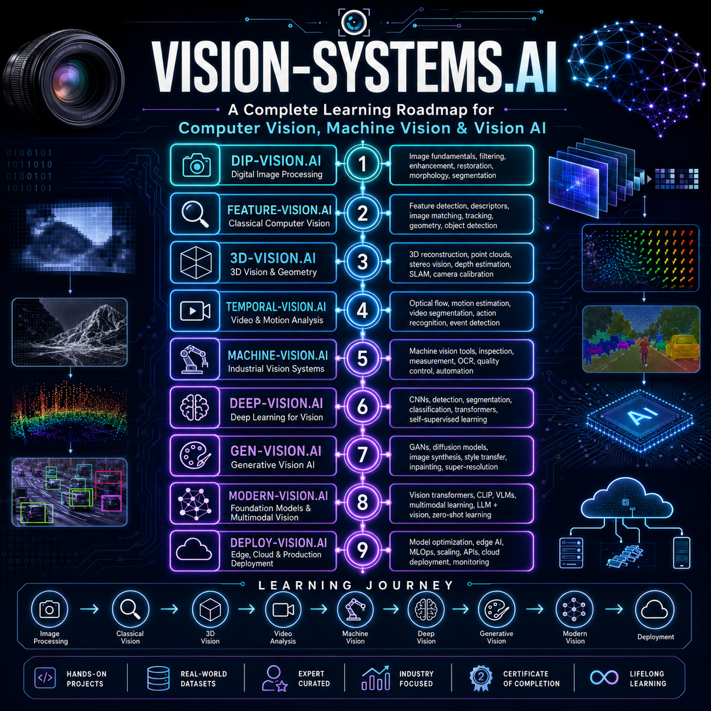

# Vision-Systems.AI 2026

Welcome to the official course homepage for [Vision-Systems.AI](https://purus15987.github.io/vision-systems.ai/), a comprehensive Computer Vision and AI course designed to bridge the gap between theory, research, and real-world applications.

The course is taught by [M. Purushotham](https://github.com/purus15987), AI/ML Researcher specializing in Generative AI and Computer Vision.

---

## 📚 Course Modules

The course is organized into nine progressive modules that take you from the fundamentals of image processing to deploying modern vision systems.
1. [DIP-Vision.AI](lectures/modules/dip-vision.ai.md) – Digital Image Processing
2. [Feature-Vision.AI](lectures/modules/feature-vision.ai.md) – Feature Detection and Image Representation
3. [3D-Vision.AI](lectures/modules/3d-vision.ai.md) – Geometry and Three-Dimensional Vision
4. [Temporal-Vision.AI](lectures/modules/temporal-vision.ai.md) – Video Analysis and Motion Understanding
5. [Machine-Vision.AI](lectures/modules/machine-vision.ai.md) – Industrial and Applied Vision Systems
6. [Deep-Vision.AI](lectures/modules/deep-vision.ai.md) – Deep Learning for Computer Vision
7. [Gen-Vision.AI](lectures/modules/gen-vision.ai.md) – Generative Models and Vision Foundation Models
8. [Modern-Vision.AI](lectures/modules/modern-vision.ai.md) – Vision Transformers and State-of-the-Art Architectures
9. [Deploy-Vision.AI](lectures/modules/deploy-vision.ai.md) – Model Optimization and Deployment

---

## 🎯 Learning Outcomes
By the end of this course, students will be able to:
- Understand the fundamentals of digital image processing.
- Build feature extraction and image analysis pipelines.
- Develop 3D vision and geometric computer vision applications.
- Analyze motion and temporal information from videos.
- Train deep learning models for computer vision tasks.
- Work with modern Vision Transformers and foundation models.
- Build generative vision applications.
- Deploy computer vision models for real-world use.

---

## 🗂️ Course Resources
- 📘 [Course Overview](lectures/course-overview.md)
- 📅 [Complete Teaching Plan (Topics, Assignments, and Weekly Schedule)](lectures/teaching-plan.md)
- 🧰 [Installation & Tool Setup](lectures/installation.md)
- 📚 [Reference Books](lectures/books.md)
- 📄 [Research Papers](lectures/papers.md)
- 📂 [Datasets](lectures/datasets.md)
- 💻 [Programming Resources](lectures/programming-resources.md)

---

## 🛠 Technology Stack
Throughout the course, students will work with modern AI and Computer Vision tools including:

---

## 🚀 Get Started

> "Reality responds to what you do, not merely what you interpret."

- 📌 Follow the [**Course Instructions**](lectures/instructions.md) to begin your journey.
- 📌 [FAQs on Vision Systems](lectures/faqs.md)
- 📌 [Skills and Tools Required](lectures/skills.md)

---

## 📆 Daily Lecture Index

- [Track lecture progress and revisit key concepts anytime.](lectures/lectures.md)
> 📌 **Note:** This section will be updated **daily** after each lecture.

| 📅 Date      | 📦 Module | 🧠 Topic                         | 📁 Lecture Notes | 📚 Remarks                               |
| ------------ | --------- | -------------------------------- | ----------------- | ------------------------------------------ |
| July 01, 2026 | Intro  | Introduction to Vision-Systems.AI  | [Vision-Systems.AI](https://docs.google.com/document/d/1aiWcmJvT_FC9GUB-phA-AklMFloKALZPKVYh7ebxZxk/edit?usp=sharing)  | Course Orientation   |
| July 02, 2026 | dip-vision.ai | Digital Image Processing | [DIP-Vision.AI](https://docs.google.com/document/d/1_dgMQStxCGNuPJ0NzvpLFiL565jy_dAWxtWBe-azBEI/edit?usp=sharing)  | Fundamentals of Image Processing Systems   |
| ...          | ...       | ...                              | ...               | ...              

---

## 📑 **Assignments Index**

> ***"Build, apply, and showcase your learning –*** [***step by step.***](https://github.com/purus15987/LearnCV.ai/issues)

> [Assignment Submission Tracker CSE(AIML)-A](https://docs.google.com/spreadsheets/d/1NIQGEZTB1Byhpuvn-6rzlz9xBtkTZfxUp-M4l1CczFk/edit?usp=sharing)

> [Assignment Submission Tracker CSE(AIML)-B](https://docs.google.com/spreadsheets/d/1GZGnX9NolDM95KEZAL8gcMF_g3Li0it7DVWgYNtD8E4/edit?usp=sharing)

| 📅 **Date**  | 📝 **Task No.** | 📌 **Assignment Title**                                          | 📚 **Topics Covered**                                                                  | 🔗 **Link**                                                           |
| ---------------- | --------------------- | ---------------------------------------------------------------- | -------------------------------------------------------------------------------------- | --------------------------------------------------------------------- |
| **July 01, 2026** | Task 1          | OpenCV Bootcamp Certification  | Digital Image Processing with OpenCV | [Task 01](lectures/assignments/task01.md) |
| **July 02, 2026** | Task 2          | Kaggle Data Visualization Certification | Matplotlib and Seaborn for Data Visualization | [Task 02](lectures/assignments/task02.md) |
| **July 03, 2026** | Task 3          | CodeSignal Streamlit Certification|  Making a Frontend for our Researcher with Streamlit| [Task 03](lectures/assignments/task03.md) |
| ...          | ...            | ...                                  | ...                                      | ...            |

---

## 🔬 **Lab Index**

***"Where theory meets practice –*** [***explore, implement, and innovate."***](lectures/labs.md)

| 📅 **Date**  | 📦 **Lab No.** | 🧠 **Lab Title**                     | 📚 **Topics Covered**                    | 🔗 **Link**     |
| ------------ | -------------- | ------------------------------------ | ---------------------------------------- | --------------- |
| July 02, 2026 | Practice 1 | OpenCV Tutorial  | Image processing and Video analysis   | [OpenCV Tutorial Colab](https://colab.research.google.com/drive/1JvcrQ6la0fesMziy9uFpLvFwKkfWWtmB?usp=sharing)  |
| ...          | ...            | ...                                  | ...                                      | ...            |

---

## 💡 Projects

***"Where theory meets practice –*** [***explore, implement, and innovate."***](lectures/labs.md)

| 📅 **Date**  | 📦 **Project No.** | 🧠 **Project Title**                     | 📚 **Topics Covered**                    | 🔗 **Link**     |
| ------------ | -------------- | ------------------------------------ | ---------------------------------------- | --------------- |
| July 04, 2026 | Project 1 | Image Processing Toolkit  | Fundamentals of Digital Image Processing   | [Project 1 Instructions](projects/projects01/index.md)  |
| July 12, 2025 | Project 2 | Feature Vision Systems | Classical Computer Vision & Feature Engineering Techniques | [Project 2 Instructions](projects/projects02/index.md)
| ...          | ...            | ...                                  | ...                                      | ...            |

---
## 🌍 FAQs (Frequently Asked Questions)

Whether you are just starting out, curious about the field, or looking for guidance on careers, skills, or resources—this is the place to begin.

👉 [Click here to view](lectures/faqs.md): FAQs on Vision Systems

---

## 👨‍🏫 Instructors

**Mr. Purushotham Mailapalli**  
Assistant Professor, JBIET College, Hyderabad  

Areas of Interest
- Computer Vision
- Generative AI
- Deep Learning
- Machine Learning
- Vision Foundation Models

Contact Info: [purus15987@gmail.com](mailto: [purus15987@gmail.com]')
📎 [GitHub](https://github.com/purus15987) | [LinkedIn](https://www.linkedin.com/in/purus15987)

---

> ⚠️ **Note**: This site is under active development. Bookmark it for regular updates!